# Complete Chat Archive: Invoice Automation to Multi-Branch Finance Operations Platform

> Compiled from the conversation. This document preserves the user's questions, the supplied Indian finance-process notes, and the assistant's explanations, workflows, architecture recommendations, scenarios and implementation guidance. Examples and figures are illustrative unless stated otherwise. Tax rates, thresholds and statutory deadlines must be verified with Terasoft's Chartered Accountant and current official guidance before implementation.

## Contents

1. Initial invoice workflow: current vs AI Agent workflow
2. Extending invoice processing into a full Finance Operations Platform
3. Indian procure-to-pay and Accounts Payable process supplied in the conversation
4. Multi-branch delivery and invoice processing scenario
5. Consolidated product and architecture conclusions
6. Open decisions for the next PRD and system design

---

# 1. Initial invoice workflow: current vs AI Agent workflow

## User question

> what is the invoice flow currentlly give a workflow diagram and what would be the new workflow be with AI Agents

## Assistant response

### Invoice Processing System: Current Workflow vs AI Agent-Based Workflow

The project's goal is to collect invoices from Gmail, WhatsApp and manual uploads, extract invoice data, validate it, and prepare or post invoice transactions to Tally/ERP.

The key distinction is that the current design is primarily a **rule-based workflow with AI-powered document extraction**. The proposed design introduces specialized AI Agents coordinated by an Orchestrator Agent.

## 1.1 Current invoice processing workflow

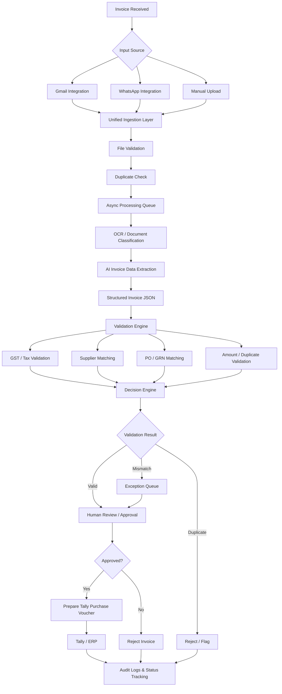

### Current workflow stages

| Stage | What happens |
|---|---|
| 1. Invoice intake | Invoice comes from Gmail, WhatsApp or upload. |
| 2. Ingestion | Files enter a unified processing pipeline. |
| 3. File validation | PDF, PNG, JPEG and file integrity checks. |
| 4. Duplicate detection | Checks whether the same email attachment or invoice was received before. |
| 5. OCR | Extracts readable text from invoice images/PDFs. |
| 6. AI extraction | Extracts invoice number, GSTIN, supplier, dates, tax and total amount. |
| 7. Validation | Checks GST, supplier, PO, GRN, amounts and duplicates. |
| 8. Decision engine | Categorizes records as valid, mismatched or duplicate. |
| 9. Human approval | User reviews and approves/rejects. |
| 10. ERP integration | Approved invoice is prepared or posted as a Tally purchase voucher. |
| 11. Audit | Tracks status, errors, retries and activity. |

### Current architecture limitations

- Most decisions are predefined rules.
- Extraction may use AI, but validation and routing are mostly deterministic.
- Missing PO/GRN information cannot necessarily be independently resolved.
- Supplier mismatches have limited intelligent investigation.
- Exceptions require substantial manual intervention.
- Processing stages do not independently reason and collaborate.

## 1.2 Proposed AI Agent workflow

Instead of one fixed pipeline, specialized agents perform specific jobs and coordinate through an Orchestrator Agent.

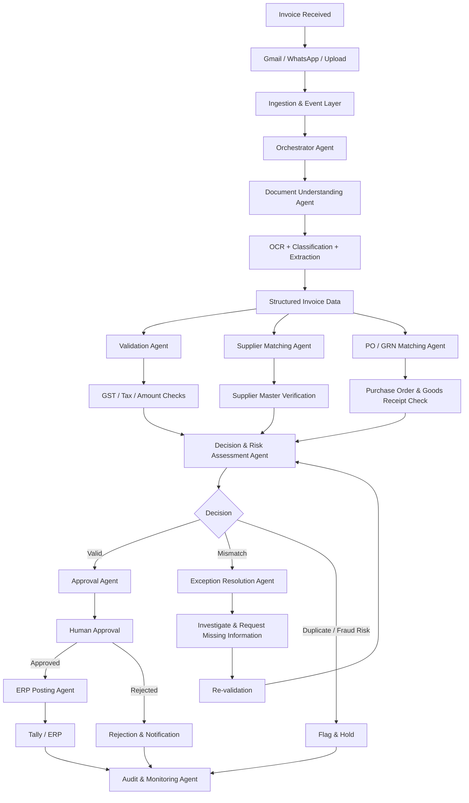

### Specialized agents and responsibilities

1. **Orchestrator Agent** — receives invoice events, assigns work, tracks state and decides which agent should execute next.
2. **Document Understanding Agent** — classifies documents, extracts fields, handles layouts and produces normalized JSON.
3. **Validation Agent** — checks required fields, GST calculations, tax breakdown, arithmetic and business rules.
4. **Supplier Matching Agent** — matches vendor records using GSTIN, vendor name, address and identifiers.
5. **PO / GRN Matching Agent** — compares invoice items with purchase orders and goods receipt notes.
6. **Exception Resolution Agent** — investigates missing fields, supplier mismatches and PO/GRN discrepancies; retrieves authorized records or requests information.
7. **Decision & Risk Assessment Agent** — combines validation outcomes, matching results, confidence and risk indicators to recommend approval, hold or rejection.
8. **ERP Posting Agent** — prepares the Tally purchase voucher and submits it after authorized approval.
9. **Audit & Monitoring Agent** — tracks executions, failures, retries, status and recurring problems.

### Example agent interaction

Example invoice:

| Field | Example value |
|---|---|
| Supplier | ABC Technologies |
| Invoice number | INV-1024 |
| Invoice amount | ₹2,36,000 |
| GST | 18% |

The Document Agent extracts the invoice. The Validation Agent checks calculations and identifiers. The Supplier Agent checks the vendor master. The PO/GRN Agent finds that invoice quantity exceeds received quantity. The Exception Agent investigates and prepares a report. The Decision Agent puts the invoice on hold. A human resolves the discrepancy. Only then can the ERP Agent proceed after authorized approval.

### Current vs proposed architecture

| Capability | Current workflow | AI Agent workflow |
|---|---|---|
| Invoice extraction | AI/OCR extraction | Document Agent |
| Classification | Predefined processing | Intelligent classification |
| GST validation | Rule-based checks | Validation Agent |
| Supplier matching | Database matching | Supplier Agent |
| PO/GRN matching | Fixed matching logic | Matching Agent + investigation |
| Duplicate detection | Rule-based | Contextual investigation alongside deterministic checks |
| Exception handling | Manual queue | Exception Resolution Agent |
| Decision making | Predefined decision engine | Agent-assisted risk assessment |
| Human approval | Required | Required |
| Tally integration | Voucher preparation/posting | ERP Posting Agent |
| Monitoring | Logs and status tracking | Audit Agent + execution monitoring |

### Recommended technical architecture

| Layer | Suggested technology |
|---|---|
| Backend | Python + FastAPI |
| Agent framework | Agno |
| Database | PostgreSQL |
| Queue | Redis + Celery |
| OCR | PaddleOCR / document extraction models |
| LLM | Hugging Face-hosted or self-hosted open models |
| File storage | Private local or S3-compatible storage |
| Frontend | React + TypeScript |
| ERP | Tally integration |
| Monitoring | Structured logs + execution traces |

Agno may be used for agent orchestration, but database state, queues, permissions, validation and approval controls should remain explicit backend responsibilities.

### Recommended implementation phases

- **Phase 1 – Intelligent Processing:** Orchestrator, Document Agent, Validation Agent and Supplier Matching.
- **Phase 2 – Autonomous Investigation:** PO/GRN Agent, Exception Resolution Agent and Decision Agent.
- **Phase 3 – Controlled Execution:** Human approval, ERP Posting Agent, audit and monitoring.

### Important boundary

Agents can investigate and recommend financial actions. They should not independently approve invoices, modify supplier bank details or initiate payments. These actions need explicit authorization and audit controls.

---

# 2. Extending invoice processing into a full Finance Operations Platform

## User question

> what will be the extended process or workflow for full stack were we can grow into a depatment and what are the parallel works or dependencies allong with this invoice flow

## Assistant response

### Full-Stack AI Finance & Invoice Automation Platform

The product should grow from an invoice automation tool into an **AI-powered Finance Operations Platform**. Invoice automation should be the first module, not the whole product.

Potential department-level modules:

- Accounts Payable (AP)
- Procurement
- Accounts Receivable (AR)
- Expense Management
- Treasury and Payments
- Reconciliation
- General Ledger and Accounting
- Tax and Compliance
- Financial Reporting and Analytics
- AI Finance Assistant

## 2.1 Department-wide finance workflow

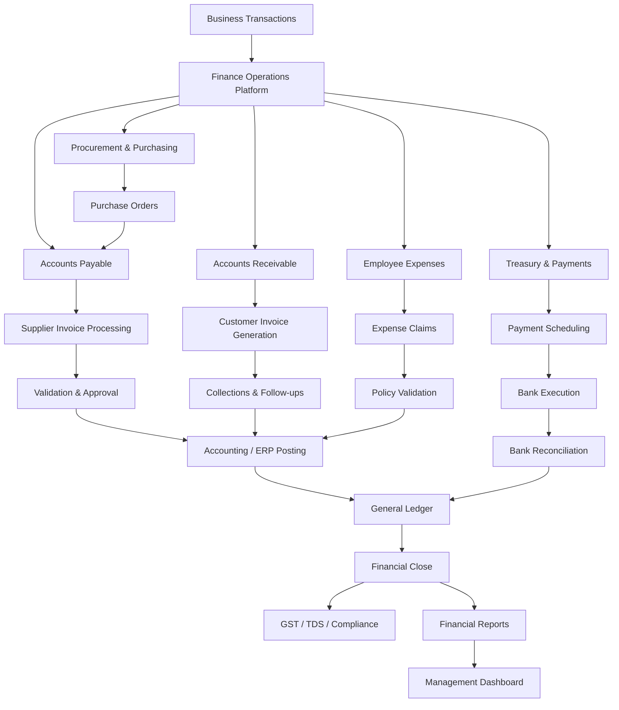

The invoice is one step in a longer procure-to-pay and finance process. The platform should manage the transaction from origin through accounting, payment, reconciliation and financial reporting.

## 2.2 Extended invoice-to-financial-close workflow

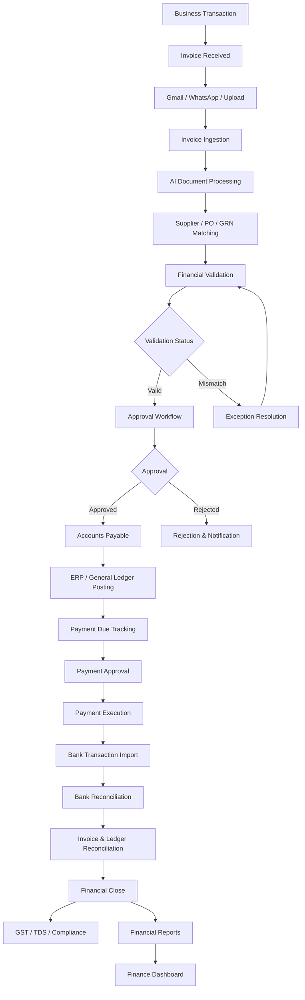

| Stage | Module | Business outcome |
|---|---|---|
| 1 | Invoice Intake | Documents received and registered |
| 2 | Document Intelligence | Invoice data extracted |
| 3 | Vendor & PO Matching | Supplier and purchase verification |
| 4 | Validation | Tax and financial correctness |
| 5 | Approval | Authorized invoice approval |
| 6 | Accounts Payable | Outstanding liability recorded |
| 7 | ERP Posting | Purchase voucher created |
| 8 | Payment Management | Payment due dates tracked |
| 9 | Payment Execution | Authorized supplier payment |
| 10 | Bank Reconciliation | Payment matched with bank records |
| 11 | Financial Close | Accounts finalized for a period |
| 12 | Compliance & Reporting | Statutory and management reporting |

## 2.3 Business modules

### 1. Accounts Payable (build first)

- Invoice ingestion and extraction
- Supplier verification
- PO/GRN matching
- Invoice approval
- Payment due tracking
- Vendor statement reconciliation

### 2. Procurement Management

- Purchase requisitions
- Purchase order creation
- Multi-level approvals
- Vendor quotations
- Goods receipt notes
- PO vs invoice matching

### 3. Accounts Receivable

- Customer invoice generation
- Invoice delivery
- Outstanding receivables
- Payment tracking
- Automated payment reminders
- Customer account reconciliation

### 4. Expense Management

- Employee expense submissions
- Receipt extraction
- Expense policy validation
- Travel and accommodation claims
- Reimbursement approvals

### 5. Treasury & Payments

- Payment scheduling
- Cash flow monitoring
- Supplier payment prioritization
- Payment approval matrix
- Bank integrations
- Payment status tracking

### 6. Reconciliation Management

- Bank statement ingestion
- Invoice-to-payment matching
- Ledger reconciliation
- Unmatched transaction investigation
- Reconciliation reports

### 7. General Ledger & Accounting

- Chart of accounts
- Journal entries
- Ledger mapping
- Trial balance
- Period closing
- Accounting adjustments

### 8. Tax & Compliance

- GST data management
- GSTR reconciliation
- Input tax credit checks
- TDS calculations and tracking
- Compliance calendar
- Audit documentation

### 9. Financial Reporting & Analytics

- Profit and loss
- Balance sheet
- Cash flow statement
- AP/AR ageing
- Vendor spending analysis
- Department-wise expenditure

### 10. AI Finance Assistant

- Answer questions about authorized company finance data
- Explain unusual transactions
- Generate financial summaries
- Investigate overdue invoices
- Prepare approval recommendations
- Explain financial trends

## 2.4 Parallel development workstreams

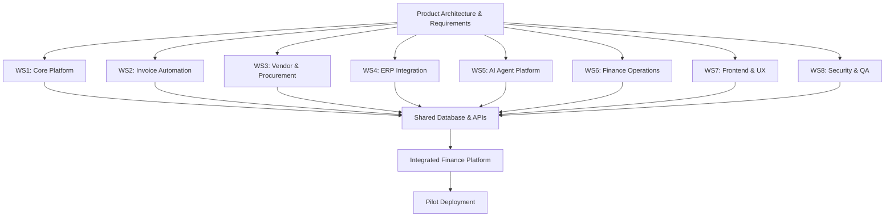

### Workstream 1 – Core platform infrastructure

- Authentication: login, sessions and OAuth
- Multi-tenancy: multiple companies and entities
- RBAC: roles and permissions
- Organization: companies, branches and departments
- Vendor master: supplier records
- Customer master: customer records
- Document storage: secure document management
- Audit system: record important actions
- Notification service: email, WhatsApp and in-app notifications
- Workflow engine: approval and task management

### Workstream 2 – Invoice automation

- Gmail integration
- Manual document upload
- WhatsApp integration
- OCR and extraction
- Duplicate detection
- GST and financial validation
- PO/GRN matching
- Human approval
- Tally voucher creation
- Exception management

Keep Gmail and manual upload in the initial MVP. Build a shared ingestion interface so WhatsApp can be added when its integration is ready.

### Workstream 3 – Procurement and vendor management

- Vendor registration and onboarding
- GSTIN verification
- Vendor master records
- Purchase requisitions
- Purchase order management
- GRN management
- Vendor performance tracking

Invoice matching requires supplier, PO and GRN data. Procurement can be developed in parallel, but end-to-end matching tests need those records and APIs.

### Workstream 4 – ERP and accounting integration

- Tally connection
- Ledger synchronization
- Supplier master synchronization
- Purchase voucher creation
- Journal voucher support
- Payment voucher support
- Posting confirmation
- Error handling and retry
- Reconciliation of ERP records against platform records

Initially, Tally should remain the accounting system of record. The platform should orchestrate workflows and maintain operational records rather than replace the accounting ledger immediately.

### Workstream 5 – AI Agent infrastructure

Build a shared runtime rather than disconnected agents:

- Orchestrator
- Agent registry
- Tool registry
- Agent communication contracts
- Structured output schemas
- Execution state management
- Retry and timeout handling
- Human-in-the-loop checkpoints
- Agent traces and evaluation
- Permission-controlled tool execution

| Agent | Dependencies |
|---|---|
| Document Agent | OCR and document storage |
| Validation Agent | Invoice schema and business rules |
| Supplier Agent | Vendor master |
| PO/GRN Agent | Procurement APIs |
| Exception Agent | Validation and matching results |
| Decision Agent | Policy engine and risk rules |
| ERP Agent | Tally integration |
| Finance Assistant | Accounting and finance data |

### Workstream 6 – Other finance operations

- Accounts Receivable
- Employee expense management
- Payment tracking
- Bank statement ingestion
- Cash flow dashboard
- Reconciliation

### Workstream 7 – Frontend and user experience

Suggested pages:

1. Executive dashboard
2. Invoice inbox
3. Invoice review and approval
4. Exception management
5. Vendor management
6. Purchase orders
7. Payments
8. Expenses
9. Bank reconciliation
10. Reports and analytics
11. AI Finance Assistant
12. Settings and permissions

### Workstream 8 – Security, compliance and quality

- Tenant-level data isolation
- Role-based authorization
- Approval limits
- Maker-checker controls
- Encrypted document storage
- Secret management
- Immutable audit events
- Agent action permissions
- API security
- Backup and recovery
- Integration testing
- Financial calculation testing

## 2.5 Dependency map

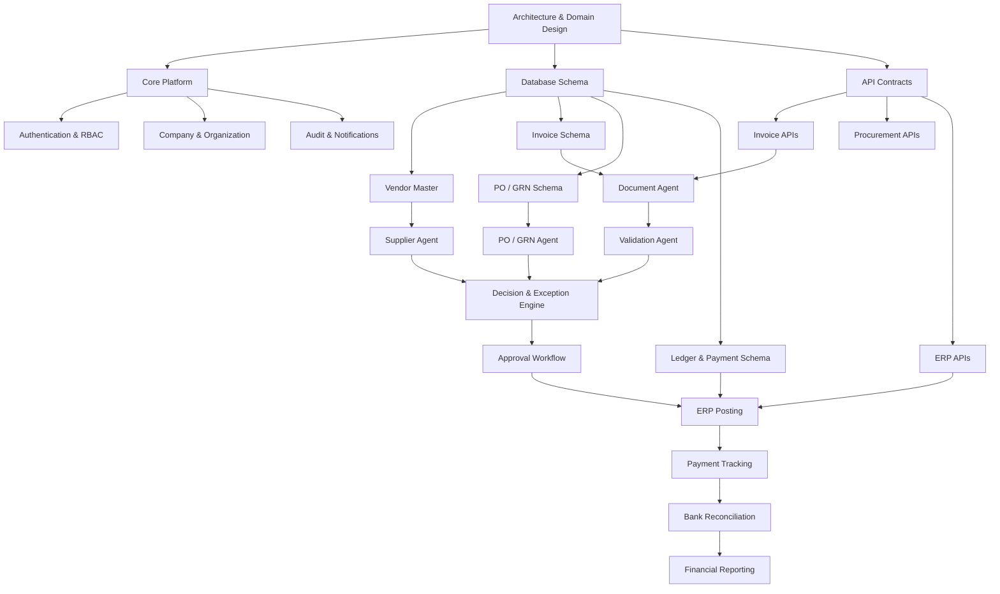

| Work | Can start independently? | Required dependency |
|---|---|---|
| Authentication | Yes | Core platform |
| Invoice extraction | Yes | Document schema |
| Gmail integration | Yes | Authentication and ingestion API |
| Manual upload | Yes | Storage and ingestion API |
| WhatsApp integration | Yes | Ingestion API and WhatsApp provider |
| Vendor management | Yes | Organization and database |
| Procurement | Yes | Vendor and organization |
| PO/GRN matching | Partially | PO/GRN records |
| Validation Agent | Partially | Invoice schema and rules |
| Exception Agent | Partially | Validation and matching outputs |
| ERP integration | Yes | ERP access and accounting mappings |
| Payment management | Partially | AP records and payment model |
| Bank reconciliation | Partially | Bank transaction and ledger data |
| Financial reporting | Partially | Reliable accounting data |

Define API contracts and schemas early so developers can work against mock APIs while dependencies are completed.

## 2.6 Shared database architecture

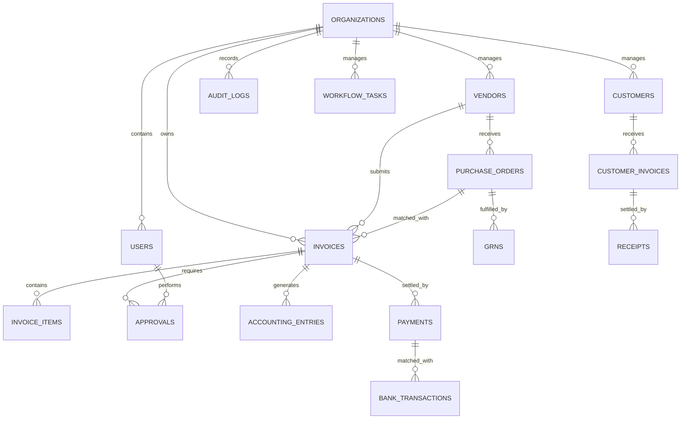

Suggested database domains:

| Domain | Important tables |
|---|---|
| Identity | users, roles, permissions, user_roles |
| Organization | organizations, branches, departments |
| Vendor | vendors, vendor_contacts, vendor_documents |
| Procurement | purchase_requisitions, purchase_orders, grns |
| Invoice | invoices, invoice_items, invoice_documents |
| Approval | approval_workflows, approvals, approval_rules |
| Accounting | chart_of_accounts, ledger_entries, journal_entries |
| Payments | payments, payment_batches, payment_methods |
| Banking | bank_accounts, bank_transactions, reconciliations |
| Expenses | expense_claims, expense_items, reimbursements |
| Compliance | gst_records, tds_records, tax_periods |
| AI | agent_runs, agent_steps, agent_tool_calls |
| Platform | audit_logs, notifications, workflow_tasks |

Every financial transaction should have a unique ID, organization ID, source document reference, status, timestamps and audit history. Use idempotency keys for posting and payment-related operations.

## 2.7 Cross-department AI Agent architecture

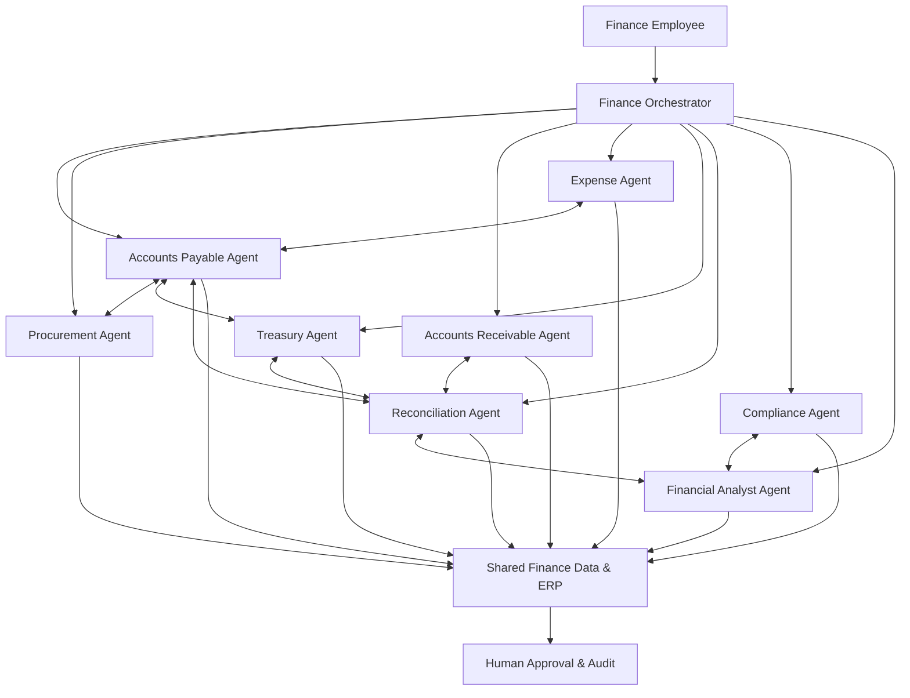

Examples:

| Scenario | Agent collaboration |
|---|---|
| Invoice arrives | AP + Document + Validation |
| PO mismatch | AP + Procurement |
| Supplier payment due | AP + Treasury |
| Payment completed | Treasury + Reconciliation |
| Customer payment overdue | AR + Finance Assistant |
| Employee submits expense | Expense + Validation |
| GST mismatch | AP + Compliance |
| Monthly financial report | GL + Reconciliation + Analyst |

Avoid uncontrolled agent-to-agent conversations. Use event-driven communication and explicit task contracts. Example events:

- `invoice.approved` → Payment Scheduling Workflow
- `payment.completed` → Bank Reconciliation Workflow
- `reconciliation.completed` → Financial Reporting Workflow

## 2.8 Full-stack technical architecture

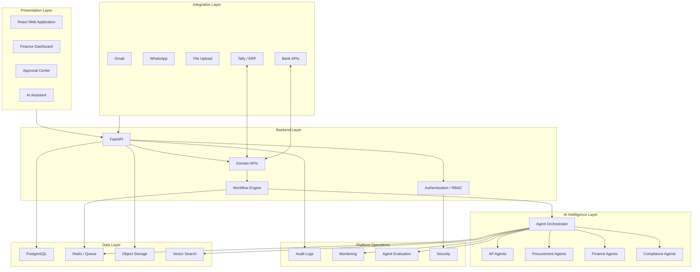

Recommended stack:

| Layer | Recommendation |
|---|---|
| Frontend | React + TypeScript |
| Backend | FastAPI + Python |
| Agent framework | Agno |
| Database | PostgreSQL |
| Background jobs | Redis + Celery |
| File storage | S3-compatible private storage |
| OCR | PaddleOCR / specialized document models |
| LLM | Hugging Face-hosted or self-hosted open models |
| ERP | Tally integration |
| Authentication | OAuth2 + JWT / OIDC |
| Monitoring | OpenTelemetry + structured logs |
| Deployment | Docker + CI/CD |

Start with a modular monolith. Split services when workload, scaling or team ownership justifies it.

## 2.9 Indicative development roadmap

| Milestone | Indicative timeline | Scope |
|---|---|---|
| 1. Foundation | Weeks 1–3 | Database/domain schemas, authentication, RBAC, organization, vendor/customer master, storage, audit, API contracts |
| 2. Invoice Intelligence | Weeks 3–6 | Gmail/upload ingestion, extraction, validation, supplier matching, duplicate detection, human review |
| 3. Procurement & ERP | Weeks 5–8 | PO, GRN, vendor onboarding, Tally, ledger mapping, voucher creation, matching |
| 4. Finance Operations | Weeks 8–12 | AP, payment tracking, expenses, AR, bank ingestion, reconciliation |
| 5. Agent Intelligence | Weeks 10–15 | Orchestration, exception investigation, decision support, finance assistant, cross-module collaboration, evaluation |
| 6. Department Platform | Weeks 15–20 | Compliance, reports, cash flow, period closing, multi-company support, production hardening |

These are planning estimates, not guaranteed delivery dates. Actual timing depends on team size, code quality and integration access.

## 2.10 Suggested team ownership

For a six-person team:

| Developer | Ownership | Responsibilities |
|---|---|---|
| Developer 1 | Core backend | Auth, organizations, database, shared APIs |
| Developer 2 | Invoice automation | Ingestion, extraction, validation |
| Developer 3 | AI agents | Orchestrator, tools, exception handling |
| Developer 4 | Procurement & ERP | Vendor, PO, GRN, Tally |
| Developer 5 | Frontend | Dashboard, review, approvals |
| Developer 6 | Finance operations & QA | Payments, reconciliation, testing |

Architecture, code reviews, integration testing, security and deployment remain shared responsibilities.

## 2.11 Critical dependencies

| Dependency | Why it matters | Priority |
|---|---|---|
| Accounting system of record | Determines where final ledger data lives | Critical |
| Vendor master ownership | Needed for supplier workflows | Critical |
| Approval hierarchy | Determines who can approve what | Critical |
| Chart of accounts | Required for accounting entries | Critical |
| PO/GRN availability | Determines matching capability | High |
| GST and TDS data sources | Determines compliance capabilities | High |
| Bank integration access | Required for reconciliation | Medium |
| WhatsApp Business API | Required for WhatsApp ingestion | Medium |
| Customer and employee master | Required for AR and expenses | High |

Financial controls:

- Invoice approval limits based on roles.
- Segregation of duties.
- No duplicate ERP posting.
- No unauthorized supplier master changes.
- No autonomous payment execution.
- Full audit trail for every agent action.
- Explicit human authorization for sensitive financial operations.

GST and TDS workflows must reflect applicable statutory requirements and be validated by qualified finance professionals. An LLM should not be the tax calculation authority.

## 2.12 Recommended implementation strategy

### Phase 1 – Complete Accounts Payable

1. Company and user management.
2. Vendor master management.
3. Gmail and manual invoice ingestion.
4. Document extraction and validation.
5. PO/GRN matching.
6. Approval and exception workflows.
7. Tally voucher posting.
8. Payment due tracking.
9. Bank reconciliation.
10. AP ageing and expenditure reporting.

### Phase 2 – Expand into department operations

Add Procurement, AR, Expenses, Treasury and Compliance.

### Phase 3 – Add the intelligence layer

Add cross-module AI agents, finance assistant, predictive insights and department-wide automation.

The rationale: a complete AP workflow creates shared building blocks for other departments: suppliers, documents, approvals, accounting entries, payments and audit records.

---

# 3. Indian procure-to-pay and Accounts Payable process supplied in the conversation

## User-provided process notes

> Here is how this works in a typical Indian company, using GST, TDS and Tally. Rates and thresholds change, so your CA should confirm the specifics for Terasoft. I haven't looked at your codebase for this answer.

## 3.1 Big picture: procure-to-pay

The invoice is only step 5 of a longer chain:

1. A department needs something and raises a requisition.
2. Purchase gets quotes and issues a PO with price, quantity and terms.
3. The supplier delivers, with a delivery challan.
4. Stores or the requester checks the goods and signs a GRN (goods receipt note).
5. The supplier's invoice arrives.
6. AP (accounts payable) checks it against the PO and GRN, codes it, gets it approved and books it.
7. Finance pays on the due date.
8. Reconciliation covers bank, supplier statement, GST and TDS.

Different people own different steps:

- Purchase owns the supplier relationship and price.
- Stores owns the physical goods.
- AP checks and books.
- The finance head approves payments.
- A CA handles tax filings.

## 3.2 When an invoice arrives

### 1. Register it

The invoice goes into an inward register with its received date. The date matters because some deadlines may run from it. Proformas, quotations and statements are separated out because they are not bills to pay.

### 2. Check the supplier

Finance verifies:

- Is the supplier already in the vendor master?
- Is the GSTIN active, and do PAN and name match?
- Are bank details the same as before? A changed bank account must be verified using a known supplier contact number, not a number supplied on the invoice.
- Is the supplier an MSME? Applicable payment timelines must be checked against current law and the supplier's status.

### 3. Check the invoice itself

- Required fields: GSTINs, invoice number and date, HSN, place of supply and rate.
- IGST versus CGST+SGST must match the relevant transaction facts.
- Arithmetic and dates must be checked.
- E-invoice IRN and QR code must be present when applicable under the current turnover threshold and rules.
- Duplicate invoice checks must be performed.

### 4. Match it to what was ordered and received

- **Goods:** three-way match PO vs GRN vs invoice for item, quantity, rate and terms, within approved tolerance.
- **Services:** no physical GRN is normally available; the department head confirms work using a completion note, timesheet or milestone sign-off.
- Finance relies on the receiving evidence from stores/requester; if required receipt evidence is missing, the invoice waits or follows an approved exception path.

### 5. Decide tax treatment

**Input Tax Credit (ITC):**

- Check whether the category is eligible or blocked under applicable GST rules.
- Check supplier filing and the relevant GSTR-2B records before claiming ITC, according to the applicable process.
- Monitor payment-related ITC reversal rules and applicable time limits.

**TDS:**

- Determine the applicable section based on the transaction type, such as contractor, professional/technical service, rent or specified goods purchases.
- Validate PAN and applicable rate/threshold using the current tax configuration.

**Reverse Charge Mechanism (RCM):**

- Identify transactions where the recipient may be liable to pay GST under RCM.
- Verify the supplier and service/category conditions against current rules.

### 6. Code it

Choose the expense account, department, cost centre and project. Decide whether the purchase is a capital asset or expense. Capital items may need fixed-asset register treatment and depreciation.

### 7. Approve

An approval matrix applies. For example, different approvers may be required for different invoice values or cost centres. The person who enters an invoice should not be the same person who approves or pays it (segregation of duties).

### 8. Book it in the ledger

Illustrative service transaction: taxable service ₹1,00,000 + 18% GST, with an assumed 10% TDS deduction on the taxable base. This is only an arithmetic example; actual tax applicability, section, rate and accounting treatment must be confirmed.

| Account | Debit | Credit |
|---|---:|---:|
| Professional fees (expense) | 1,00,000 | |
| Input CGST | 9,000 | |
| Input SGST | 9,000 | |
| TDS payable | | 10,000 |
| Supplier (sundry creditor) | | 1,08,000 |

For goods, the debit may be Purchases or Inventory plus eligible input GST, with supplier credited, subject to accounting policy.

### 9. Pay

Payment is commonly processed on the due date, often in a batch, by NEFT/RTGS or another approved method. An authorized signatory approves it. A payment voucher generally debits the supplier and credits bank. TDS deposit and return deadlines must be maintained using current statutory configuration.

### 10. Reconcile

Finance reconciles:

- Bank statement against books.
- Supplier statement against books.
- GSTR-2B against books before claiming eligible ITC in the relevant return.
- TDS records against government records.

At month-end, finance considers accruals for goods received but not invoiced and period cut-off for invoices received late.

## 3.3 Defective or wrong products

**Who talks to the supplier:** quality problems are normally handled by stores, the requester and purchase—not finance. Finance contacts the supplier about invoice errors, missing documents, payment status, statements and tax certificates.

### Caught at delivery

1. Stores checks quantity, damage, specifications and serial numbers against the PO and challan.
2. Wrong/damaged items are recorded on the GRN as rejected or disputed, with reasons and evidence.
3. Purchase contacts the supplier and obtains a replacement or credit note, as appropriate.
4. Rejected goods go back with a return challan where applicable.
5. Finance pays only for the accepted/approved portion, following contract and accounting policy.

### Caught later, after payment or use

1. Requester or purchase raises a supplier ticket and records invoice number, serial number, photos and complaint/RMA number.
2. The outcome may be replacement, repair or refund.
3. For a refund/price reduction, the appropriate supplier credit note and tax treatment are processed.
4. Finance records the required accounting adjustment and ITC adjustment, where applicable.

Illustrative debit note / purchase return entry for ₹10,000 + ₹1,800 GST returned:

| Account | Debit | Credit |
|---|---:|---:|
| Supplier | 11,800 | |
| Purchase returns | | 10,000 |
| Input GST | | 1,800 |

### While a dispute is open

The invoice or disputed portion is put on hold. Companies may pay an undisputed portion or retain an amount if the contract and policy allow it.

## 3.4 Other cases finance regularly encounters

| Case | Typical handling |
|---|---|
| Invoice with no PO | Budget-owner approval and policy-exception marking, where permitted |
| Price or quantity differs from PO | Pass within approved tolerance; otherwise resolve with purchase/supplier |
| Partial deliveries or several invoices per PO | Track remaining quantity/value at PO-line and schedule level |
| Wrong buyer GSTIN or tax type | Request corrected supplier documentation and evaluate ITC impact |
| Advance paid / proforma | Adjust the advance against the final invoice |
| Credit/debit notes, rate differences, rebates | Book and link to original invoice/transaction |
| Imports | Bill of entry, customs duty, forex and applicable tax/TDS processes |
| Recurring bills | Recurring workflow or provision according to policy |
| Contractor running bills | Percentage completion, retention and milestone approvals |
| Transport/GTA and unregistered suppliers | Evaluate RCM and other applicable tax rules |
| Capital purchases | Fixed-asset register, capitalisation and depreciation |
| Invoice dated before year-end, received after | Apply accounting cut-off and accrual rules |
| Supplier cancelled or blacklisted | Block or hold and escalate |
| Fraud patterns | Detect fake vendors, split invoices and bank-detail changes |

## 3.5 Where finance teams spend their time

A large share of operational effort is spent chasing approvals, stores for missing GRNs, suppliers for corrected invoices, and resolving tax mismatches at month end. Data entry is only one part of the work.

## Assistant's interpretation and product implications

The previous architecture needed to expand beyond invoice extraction. Additional business modules include:

| New module | Responsibility | Priority |
|---|---|---|
| Purchase Requisition | Department purchase requests | High |
| Purchase Order Management | Quotations, PO creation and approval | Critical |
| Goods Receipt & Quality | GRN, accepted/rejected quantities and evidence | Critical |
| Service Completion | Service confirmation, timesheets and milestones | High |
| Vendor Risk Management | GSTIN, PAN, MSME and bank verification | Critical |
| Tax Intelligence | ITC, TDS, RCM and GSTR-2B checks | Critical |
| Expense & Ledger Coding | Expense accounts, cost centres and capitalisation | High |
| Approval Management | Approval matrix and segregation of duties | Critical |
| Payment Management | Due dates, payment batches and authorization | High |
| Dispute & Returns | Defective goods, debit notes, credit notes and RMA | High |
| Reconciliation | Bank, supplier, GST and TDS reconciliation | Critical |
| Month-End Closing | Accruals and accounting cut-off | High |

### Updated procure-to-pay workflow

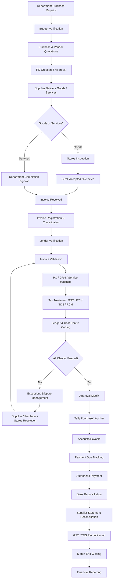

### Additional AI Agents

| Agent | Responsibility |
|---|---|
| Procurement Agent | Requisitions, vendor quotations and PO workflows |
| GRN & Quality Agent | Organizes goods-receipt evidence and accepted/rejected quantities |
| Vendor Verification Agent | GSTIN, PAN, MSME and bank-detail verification support |
| Service Verification Agent | Timesheets, milestone and completion evidence |
| Tax Intelligence Agent | GST, ITC, TDS and RCM validation support |
| Accounting Coding Agent | Ledger, cost centre and capital/expense classification recommendations |
| Approval Orchestrator | Routes tasks to authorized approvers based on policy |
| Dispute Resolution Agent | Invoice disputes, defective goods and credit-note workflows |
| Payment Scheduling Agent | Due-date tracking and payment proposals |
| Reconciliation Agent | Bank, vendor, GST and TDS matching |
| Financial Close Agent | Accruals, cut-off and closing checks |

Agents should use deterministic accounting and tax rules wherever possible. LLMs may investigate exceptions and interpret documents, but should not independently determine statutory tax liability.

### Responsibility separation

- Stores: physical inspection, rejection and GRN evidence.
- Requester: confirms service/product requirements.
- Purchase: contacts suppliers and manages replacements.
- Accounts Payable: holds/adjusts invoices and records credit/debit notes.
- Finance Head: authorizes financial adjustments and payments.

---

# 4. Multi-branch delivery and invoice processing scenario

## User question

> now you have understood the complete thing right what is the scenarios and what is the use case and all so check that and generate a PRD and reasonable document or ppt for illustrative understanding

Before the PRD/PPT was generated, the user asked a follow-up:

> here i have another doubt that if we have 5different branches in different cities so product deliveries in one city and invoice will sent to main branch so here how they confirm the product status and all with this stuff how human does tell me everyting

## Assistant response

### Multi-Branch Invoice & Goods Receipt Management

In a company with five branches in different cities, the invoice-receiving office, goods-receiving branch and payment team can be in different locations.

**The receiving branch confirms the physical goods. Central Accounts Payable verifies financial documents. Finance authorizes payment.** The head office must not infer that goods were delivered merely because it received an invoice.

## 4.1 Example company structure

Illustrative company layout:

- Head Office – Hyderabad: central purchase, AP and finance.
- Branch 01 – Bengaluru: goods receiving.
- Branch 02 – Chennai: goods receiving.
- Branch 03 – Vijayawada: goods receiving.
- Branch 04 – Pune: goods receiving.
- Branch 05 – Mumbai: goods receiving.

| Person / Department | Responsibility |
|---|---|
| Department Requester | Requests products or services |
| Central Purchase Team | Gets quotations, creates PO and contacts supplier |
| Supplier | Dispatches products and sends invoice |
| Branch Security | Records vehicle and delivery entry |
| Branch Storekeeper | Counts and receives goods |
| Branch Quality / Technical Team | Checks product condition and specifications |
| Branch Manager | Confirms receiving and resolves branch-level issues |
| Central Accounts Payable | Processes invoices and checks documents |
| Finance Head | Approves payment |
| CA / Tax Team | Handles statutory tax and accounting compliance |

## 4.2 Example: 50 laptops distributed across five branches

A central PO is created for 50 laptops. The supplier may send several deliveries to different branches while the central purchase team manages the overall PO. The invoice may be sent to central AP. Each branch creates its own GRN.

Illustrative PO:

| Field | Example |
|---|---|
| Purchase Order | PO-2026-104 |
| Supplier | ABC Technologies |
| Total quantity | 50 laptops |
| Unit price | ₹50,000 |
| Taxable value | ₹25,00,000 |

Illustrative delivery allocation:

| Branch | Quantity |
|---|---:|
| Bengaluru | 15 |
| Chennai | 10 |
| Vijayawada | 10 |
| Pune | 10 |
| Mumbai | 5 |
| **Total** | **50** |

The supplier can send the tax invoice to central AP while the physical laptops go to the five branches. These are two separately recorded events.

## 4.3 What happens when goods arrive at a branch?

### Step 1 – Security gate entry

The security guard records:

- Supplier name.
- Vehicle number.
- Driver/courier details.
- Delivery challan number.
- Arrival date and time.
- Number of packages.
- Person or department expecting the delivery.

Security records arrival; security does not approve product quality.

### Step 2 – Storekeeper checks products

The storekeeper compares delivery challan and PO, then records item, quantity, packaging, damage, serial numbers and accessories.

Illustrative receipt:

| Product | PO quantity | Delivered | Physical result |
|---|---:|---:|---|
| Laptop Model A | 10 | 10 | 10 received |
| Laptop Model B | 5 | 5 | 4 good, 1 damaged |
| **Total** | **15** | **15** | **14 accepted, 1 disputed** |

### Step 3 – Quality inspection

The relevant technical/requesting department checks quality. Examples:

| Product | Who checks? | What they check |
|---|---|---|
| Laptops | IT team | Configuration, serial number and damage |
| Furniture | Admin / Facilities | Size, quantity, material and damage |
| Electrical equipment | Technical team | Specifications and functionality |
| Raw materials | Quality team | Quality, measurements and quantity |
| Software services | Requesting department | Deliverables and completion |

### Step 4 – Branch creates a GRN

An illustrative GRN contains:

- GRN ID: `GRN-BLR-2026-0081`
- Purchase Order: `PO-2026-104`
- Branch: Bengaluru
- Supplier: ABC Technologies
- Delivery Challan: DC-2048
- Received by: Storekeeper
- Inspection by: IT Department
- Received date
- Ordered quantity: 15
- Physically received: 15
- Accepted: 14
- Damaged/disputed: 1
- Pending delivery: 0
- Evidence: package photographs, delivery challan and serial number records
- Digital confirmation by storekeeper, IT/Quality inspector and branch manager as required by policy

A GRN is not merely a message saying products arrived. It is a business event with evidence, quantities, inspection results and responsible people. A user who has not inspected or verified the goods should not attest that the inspection occurred.

### Step 5 – Branch updates central office

After the GRN is submitted, the system notifies Head Office. AP sees accepted, disputed and pending quantities and can review the GRN, match the invoice against accepted quantities and keep disputed items on hold.

## 4.4 Central AP verification

The invoice arrives in the central office Gmail inbox. The Invoice Agent extracts invoice fields and searches the relevant PO and GRNs across branches.

Illustrative 50-laptop reconciliation:

| Branch | Ordered | Accepted | Disputed | Pending |
|---|---:|---:|---:|---:|
| Bengaluru | 15 | 14 | 1 | 0 |
| Chennai | 10 | 10 | 0 | 0 |
| Vijayawada | 10 | 8 | 0 | 2 |
| Pune | 10 | 0 | 0 | 10 |
| Mumbai | 5 | 5 | 0 | 0 |
| **Total** | **50** | **37** | **1** | **12** |

Central AP should not treat the invoice for all 50 laptops as fully verified. It should:

1. Confirm the 37 accepted units.
2. Keep the damaged unit under dispute.
3. Track the 12 pending units.
4. Ask Purchase to coordinate outstanding deliveries.
5. Follow contract and policy for booking/payment of the accepted portion.
6. Release the remaining amount only when acceptance and approval conditions are met.

A single invoice can be linked to multiple branch GRNs. One PO can be fulfilled by multiple delivery challans and invoices. The matching model must therefore support multiple related records, not assume one invoice equals one GRN.

## 4.5 Partial delivery

If a PO is for 10 computers and a branch receives 6:

1. Storekeeper checks and records 6 units.
2. Creates a partial GRN for 6.
3. Records 4 as pending.
4. Branch manager confirms receipt as required.
5. Central Purchase follows up with supplier.
6. AP matches the eligible portion in accordance with contract, invoice structure and accounting policy.

Suggested statuses:

- Awaiting delivery
- Partially received
- Fully received
- Partially accepted
- Rejected
- Inspection pending
- Closed

Received, accepted, rejected and invoiced quantities must be separate fields.

## 4.6 Defective goods

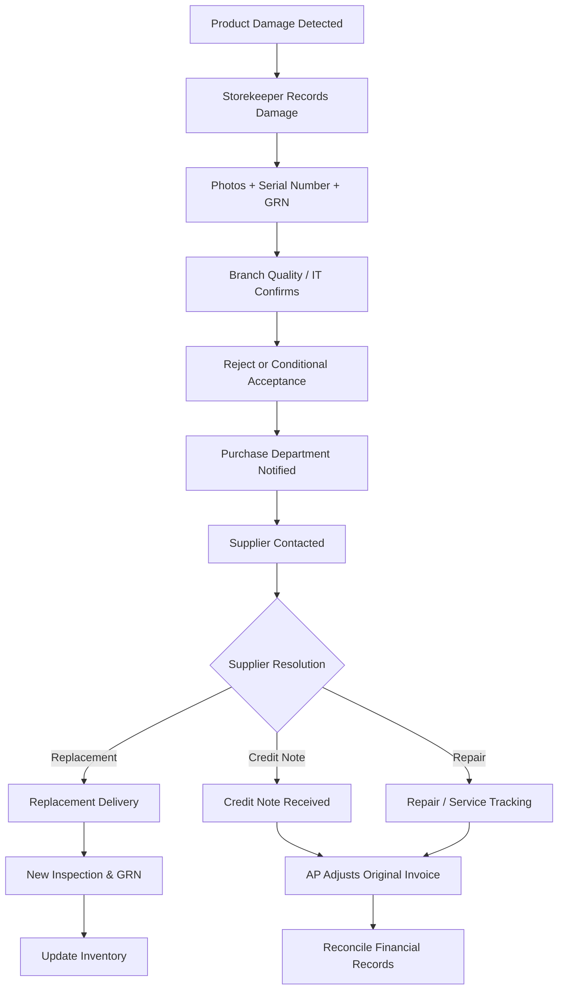

Responsibility:

| Activity | Responsible person |
|---|---|
| Report damage | Storekeeper |
| Inspect product | IT / Quality team |
| Record evidence | Storekeeper + Quality |
| Contact supplier | Purchase |
| Arrange replacement | Supplier + Purchase |
| Review credit note | Accounts Payable |
| Adjust financial entry | Accounts / Finance |
| Final approval | Authorized finance officer |

Defective products should be quarantined and not counted as available usable inventory. Branch staff should not independently alter supplier invoices or negotiate financial credit notes outside the purchase/finance process.

## 4.7 Invoice arrives before delivery

Example:

- October 27: invoice arrives at central AP.
- October 28: branch has not received goods; status remains awaiting delivery.
- October 30: goods arrive; branch creates GRN.
- After October 30: central AP matches invoice, PO and GRN and continues approval.

Invoice received does not mean goods received. Invoice approved does not mean payment approved. Maintain separate statuses for each event.

## 4.8 Service invoices

Services need a service-completion confirmation rather than a physical goods GRN.

Example: a contractor installs networking equipment at Pune branch, but sends the invoice to Hyderabad.

Pune's department manager confirms:

- Work completed.
- Agreed scope delivered.
- Hours or milestones, where applicable.
- Work quality.
- Completion date.
- Outstanding issues.

This may be represented by a Service Entry Sheet or Service Completion Certificate.

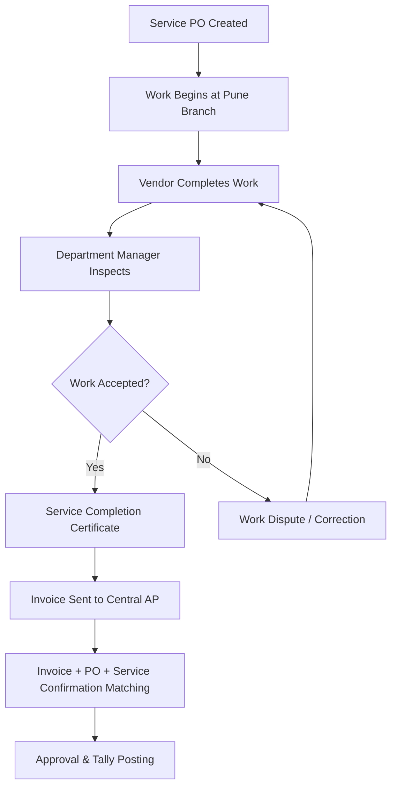

The platform needs two receipt-verification types:

- Goods receipt: GRN.
- Service receipt: service completion confirmation.

## 4.9 GST and multi-branch considerations

Different-city branches do not automatically mean separate GST registrations. However, separate registrations in different states may be required depending on the company's legal and operating structure. A company may have multiple registrations that are treated as distinct persons for GST purposes under applicable law.

The system must distinguish:

- Legal company / organization.
- GST registration.
- Operational branch.
- Physical delivery location.
- Bill-to party.
- Ship-to party.
- Inventory location.

Example bill-to / ship-to data:

| Field | Example |
|---|---|
| Supplier | ABC Technologies |
| Bill-to | Terasoft Hyderabad |
| Ship-to | Terasoft Bengaluru |
| Invoice recipient | Determined by applicable GST structure |
| Actual delivery | Bengaluru |

The appropriate place-of-supply, tax and ITC treatment depends on the purchaser, recipient, GST registrations, supplier arrangement and transaction facts. Certain bill-to/ship-to arrangements have specific place-of-supply treatment. Inter-state supplies between separately registered establishments may also have GST implications.

**Implementation recommendation:** model `Company`, `GST Registration`, `Branch/Location` and `Delivery Location` as separate entities. Do not assume they are interchangeable. Terasoft's CA should approve GST registration, bill-to/ship-to and stock-transfer configurations before production use.

## 4.10 Multi-branch workflow

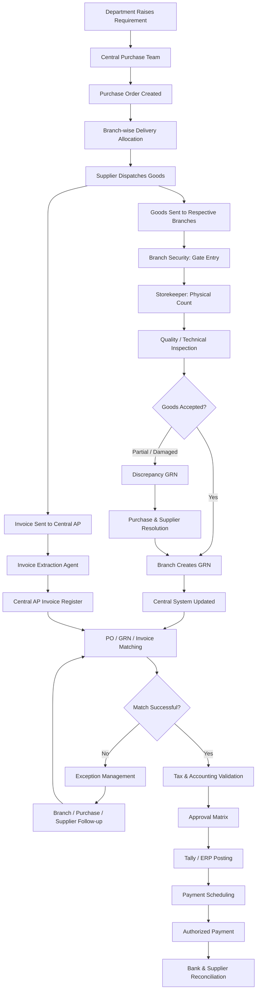

## 4.11 Branch dashboard

Each branch employee should see tasks relevant to their branch and permissions.

Example branch dashboard:

- Expected deliveries
- Inspection pending
- Disputed deliveries
- GRNs completed

Branch employee actions:

- View expected deliveries.
- Confirm vehicle arrival.
- Record received quantities.
- Add delivery photographs.
- Scan product serial numbers.
- Create GRN.
- Report damage or shortage.
- Submit inspection for approval.
- Track replacement deliveries.

## 4.12 Central finance dashboard

Head Office needs a consolidated view across all branches.

Example metrics:

- Invoices received
- Matched invoices
- Awaiting GRN
- Exceptions

Branch-wise overview:

| Branch | Delivery status | Pending action |
|---|---|---|
| Bengaluru | Partial acceptance | Dispute |
| Chennai | Completed | None |
| Vijayawada | Partial receipt | Follow-up |
| Pune | Awaiting delivery | GRN |
| Mumbai | Completed | AP matching |

Central AP actions:

- Review incoming invoices.
- Check branch GRNs.
- Match PO and invoice.
- Identify missing delivery confirmations.
- Handle supplier invoice discrepancies.
- Approve accounting entries.
- Track payment deadlines.

## 4.13 Missing branch response and escalation

If goods arrive but nobody creates a GRN, the system should not assume acceptance.

Suggested process:

1. Delivery is marked as arrived.
2. A GRN task is assigned to the branch storekeeper.
3. If no response arrives within the configured SLA, send a reminder.
4. Notify branch manager after the escalation threshold.
5. Inform central Purchase if supplier delivery is affected.
6. AP sees `Awaiting Branch Confirmation`.
7. Invoice approval remains blocked according to the company's matching policy, unless an authorized exception applies.

Illustrative configurable SLAs:

| Time / condition | Action |
|---|---|
| Delivery arrival | Notify storekeeper |
| No GRN within 4 hours | Reminder |
| No GRN within 24 hours | Notify branch manager |
| No resolution within 48 hours | Escalate to central purchase |
| Invoice payment deadline approaching | Notify AP and finance head |

These are examples, not universal company rules. Terasoft should configure actual SLAs.

## 4.14 Mixed software across branches

Branches may currently use Excel, WhatsApp, email, Tally or other ERP systems. The proposed system should support a transition from manual to digital operations.

**Manual method:** Branch receives goods → creates GRN in Excel → signs the sheet → emails it to Hyderabad → AP manually checks it.

**Proposed method:** Branch receives goods → opens branch portal → scans PO/QR code → enters accepted/rejected quantities → uploads evidence → digitally submits GRN → central AP is notified.

For branches without reliable internet or application access, consider a controlled offline/assisted process with later synchronization.

## 4.15 Multi-branch AI Agent responsibilities

| Agent | Multi-branch responsibility |
|---|---|
| Procurement Agent | Creates branch-wise purchase allocation |
| Delivery Tracking Agent | Tracks expected dispatch and delivery milestones |
| Branch Receiving Agent | Creates receiving tasks and guides storekeepers |
| Document Agent | Extracts delivery challan and invoice data |
| Quality Support Agent | Organizes inspection evidence and flags anomalies |
| GRN Matching Agent | Checks branch GRN against PO quantity |
| Invoice Matching Agent | Matches multiple GRNs with one or more invoices |
| Exception Agent | Investigates missing, damaged or short deliveries |
| Approval Agent | Routes invoice to authorized approvers |
| Tax Agent | Evaluates applicable GST/TDS rules using approved configuration |
| ERP Agent | Prepares authorized accounting entries |
| Reconciliation Agent | Matches payments and financial records |

AI cannot independently certify that a laptop is physically undamaged or that a machine works properly. A human at the receiving location must inspect and attest. AI can assist by checking documents, reading serial numbers and flagging suspicious evidence.

## 4.16 Additional multi-branch database entities

| Table | Purpose |
|---|---|
| organizations | Legal company |
| gst_registrations | State-wise GST registrations |
| branches | Registered or operational branches |
| delivery_locations | Actual goods delivery locations |
| branch_users | Employee-to-branch assignments |
| purchase_orders | PO header and commercial terms |
| po_delivery_schedules | Branch-wise quantities and delivery dates |
| shipments | Supplier dispatch details |
| goods_receipts | GRN header |
| goods_receipt_items | Accepted, rejected and pending quantities |
| inspection_records | Physical and technical inspection |
| receipt_attachments | Photographs, challans and supporting evidence |
| invoices | Central invoice register |
| invoice_po_matches | Invoice-to-PO matching |
| invoice_grn_matches | Invoice-to-GRN matching |
| disputes | Delivery and invoice discrepancies |
| supplier_credit_notes | Financial adjustments |
| approvals | Authorized user decisions |
| inventory_locations | Branch-level inventory records |

A PO should support multiple delivery schedules and destinations. An invoice should be linkable to multiple relevant receipt records where the transaction structure permits. For separately registered GST branches, support the appropriate distinct tax transactions and documents rather than treating every branch as just another inventory location.

## 4.17 Multi-branch final responsibility split

- **Branch confirms the goods.**
- **Central Accounts Payable confirms the financial documents.**
- **Finance authorizes the payment.**

One centralized system should serve multiple branch users, with a shared purchase record, documented receiving evidence and controlled financial approvals.

---

# 5. Consolidated product and architecture conclusions

## 5.1 Product definition

The product is best described as a **Multi-Branch Procure-to-Pay and Finance Operations Platform for Indian businesses**, with AI-assisted workflows.

Its core process is:

**Procurement → Goods/Services Receipt → Invoice Intelligence → Tax & Accounting → Approval → Tally/ERP → Payments → Reconciliation → Financial Closing.**

It should not be described as only an invoice extractor or as a fully autonomous finance department. It is a workflow platform with AI assistance, human controls and integrations to accounting and operational systems.

## 5.2 Key business use cases

1. Central purchase team creates a PO for goods to be delivered to multiple branches.
2. Supplier sends invoice to central AP but ships goods to branch locations.
3. Branch storekeeper records delivery and creates a GRN.
4. Technical/requesting team records inspection or service acceptance.
5. Central AP matches invoice against PO and one or more GRNs/service confirmations.
6. Shortage, damage or quality mismatch creates a dispute and hold workflow.
7. Purchase coordinates replacement, repair or credit note with supplier.
8. AP validates GST/TDS/ITC treatment with approved rules and tax records.
9. Authorized approvers approve the invoice and accounting entry.
10. ERP/Tally receives the approved voucher.
11. Finance schedules and authorizes payment.
12. Reconciliation matches bank, supplier, GST and TDS records.
13. Month-end closing produces financial reports and audit evidence.

## 5.3 Core architectural principles

1. Build a shared finance platform, not isolated feature silos.
2. Complete Accounts Payable before expanding into every finance domain.
3. Define database schemas and API contracts before parallel implementation.
4. Keep accounting calculations and financial controls deterministic.
5. Use AI agents for document understanding, investigation, coordination and decision support.
6. Keep human approval for sensitive financial actions.
7. Keep Tally as the initial accounting system of record unless there is a deliberate decision to replace it.
8. Start with a modular monolith and split services only when justified.
9. Treat security, auditability, tenant isolation and idempotency as foundational requirements.
10. Separate legal company, GST registration, branch and delivery location.
11. Keep physical receipt and inspection attestations with authorized branch personnel.
12. Support partial receipts, multiple GRNs per PO, multiple invoices per PO, partial acceptances, disputed quantities, replacements and credit notes.
13. Treat goods receipts and service completion confirmations as separate workflows.
14. Use configurable policies for approvals, tolerances and SLAs.
15. Make all agent activity observable, permissioned and auditable.

## 5.4 What should be built first

A sensible first release is an end-to-end Accounts Payable workflow, including the multi-branch receipt process:

- Organization, branch, GST-registration and user setup.
- Vendor master.
- Purchase requisition and PO basics.
- Branch-wise delivery schedules.
- Gmail and manual invoice intake.
- Branch receiving portal and GRN.
- Service completion confirmation.
- OCR and invoice extraction.
- Three-way matching and exception management.
- GST/TDS checks using configurable, CA-approved rules.
- Approval matrix and segregation of duties.
- Tally voucher integration.
- Payment due tracking.
- Audit trail and AP ageing.

Then add payment execution/reconciliation, procurement depth, AR, expense management, compliance and broader finance analytics.

---

# 6. Open decisions for the next PRD and system design

These items should be decided with Terasoft stakeholders before finalizing implementation detail:

1. **Product scope:** Is the first release AP-focused with expansion later, or does the first release include broader finance operations?
2. **Accounting system of record:** Tally Prime, another ERP, or a custom ledger?
3. **Legal entity and GST structure:** One company with multiple branches, multiple registrations, multiple legal entities, or a combination?
4. **Branch operating model:** Which branches have storekeepers, quality inspectors, branch managers and reliable application/internet access?
5. **Receiving policy:** Who can create, inspect, certify and approve a GRN? Is dual confirmation required for specific categories or values?
6. **Procurement model:** Centralized PO creation, branch-level purchasing, or hybrid?
7. **Invoice model:** Can one supplier invoice cover multiple branches? Can one PO be invoiced in multiple instalments? Are consolidated invoices permitted?
8. **Services:** What evidence is required for services—timesheets, milestone sign-off, service entry sheets or completion certificates?
9. **Tolerance policy:** What price/quantity tolerances are allowed, and who can approve exceptions?
10. **Tax ownership:** Which CA/tax team maintains GST, TDS, RCM and ITC rules? What sources and approval checkpoints are used?
11. **ERP integration:** Which Tally version and interface are available? Is posting synchronous or batch-based? What is the voucher approval process?
12. **Payment controls:** Who prepares payment batches, who authorizes them and how is bank execution integrated?
13. **Data migration:** Which vendor, branch, PO, ledger, inventory and employee masters already exist?
14. **Channels:** Are Gmail, WhatsApp Business API and manual uploads all required in MVP, or phased?
15. **Offline workflow:** Do any branches need offline GRN capture or assisted entry?
16. **Security:** Required data residency, encryption, retention, audit and backup standards?
17. **Pilot:** Which branch and transaction categories should be used for the first controlled rollout?

## Suggested next deliverable

A formal PRD and illustrative presentation should be based on the decisions above and should contain:

- Product vision, goals, non-goals and stakeholders.
- Personas and role/permission matrix.
- Complete procure-to-pay and multi-branch user journeys.
- Functional requirements by module.
- Business rules, statuses, exception paths and acceptance criteria.
- Data model and API contracts.
- Agent contracts, tools, permissions, execution state and human checkpoints.
- Tally/ERP, Gmail, WhatsApp, tax and bank integration boundaries.
- Security, auditability, reliability and observability requirements.
- Dependencies, parallel workstreams, milestones and rollout plan.
- Illustrative case studies for full receipt, partial receipt, damaged goods, invoice-before-delivery, service invoice, multiple branch deliveries and GST-registration variations.

---

## End of chat archive
